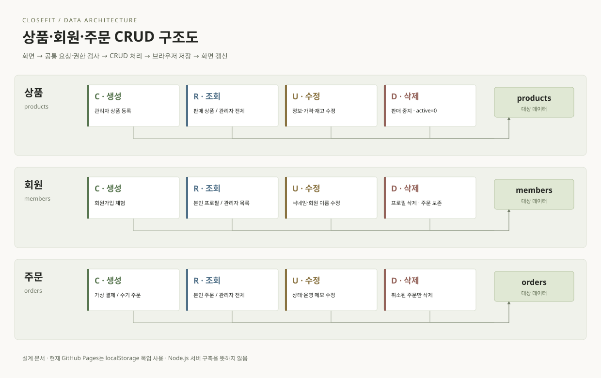
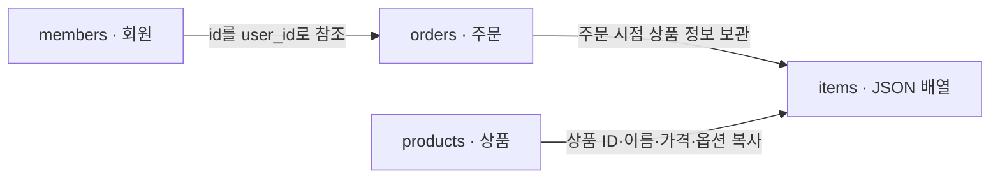
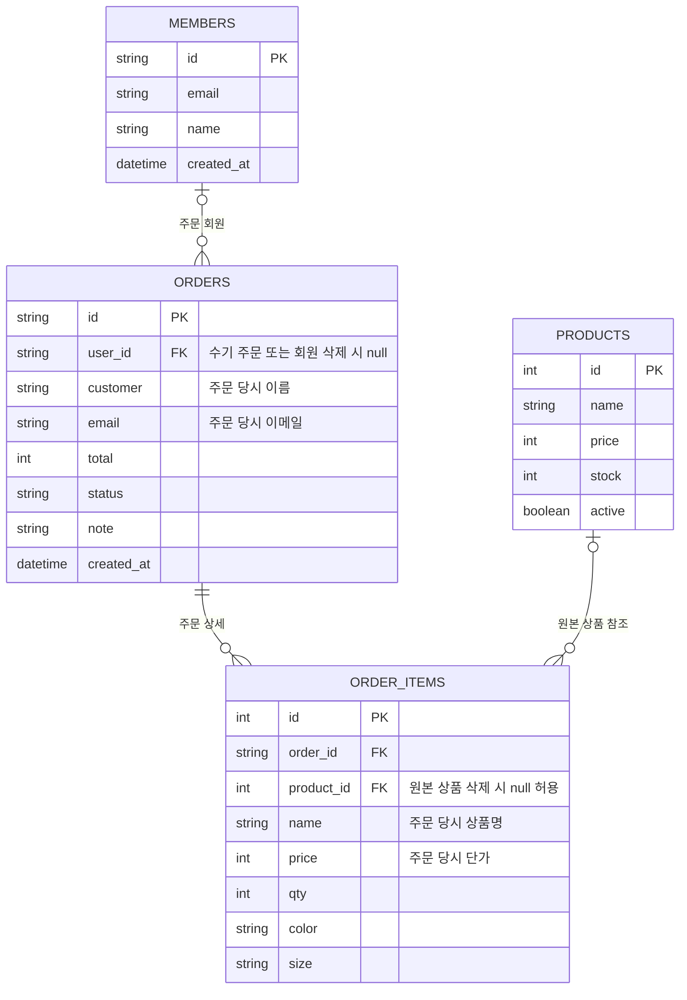
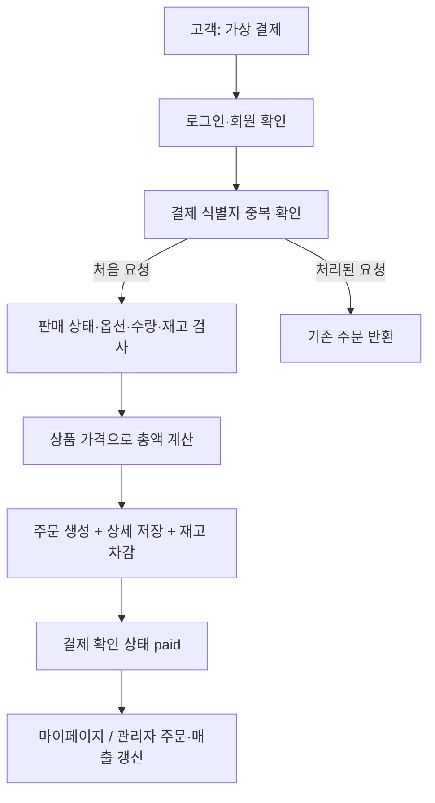

# 상품·회원·주문 DB CRUD 구조도

현재 포트폴리오의 CRUD 흐름과 향후 관계형 DB 구축 시 설계안을 설명합니다. 공개 사이트는 브라우저 목업을 사용하며, 이 문서 추가로 DB나 서버를 새로 구축하지 않습니다.

C는 생성(Create), R은 조회(Read), U는 수정(Update), D는 삭제(Delete)입니다. 각 노드는 기능을 뜻하며 독립 서버나 Node.js 모듈을 뜻하지 않습니다.

현재 처리 순서: 화면 → 공통 request() → 목업 권한·입력 검사 → CRUD → localStorage 저장 → React 화면 갱신.

## 현재 CRUD와 접근 주체

| 대상 | C 생성 | R 조회 | U 수정 | D 삭제 |
|---|---|---|---|---|
| 상품 products | 관리자 상품 등록 | 누구나 판매 중 상품, 관리자는 전체 상품 | 관리자 정보·가격·재고·판매 상태 | 관리자 판매 중지(active=0) |
| 회원 members | 비회원 회원가입 체험 | 본인 프로필, 관리자는 회원 목록 | 본인 닉네임, 관리자는 회원 이름 | 관리자 프로필 삭제, 관리자 체험 계정 제외 |
| 주문 orders | 고객 가상 결제, 관리자 수기 주문 | 고객은 본인 주문, 관리자는 전체 주문 | 관리자 상태·운영 메모 | 관리자 취소 주문만 삭제 |

회원 생성은 회원가입 흐름에서 제공합니다. 현재 관리자 회원 목록에는 직접 회원을 생성하는 기능이 없습니다. 역할 검사는 체험용이며 실제 서비스에서는 서버의 인증된 세션으로 권한과 주문 소유권을 검사해야 합니다.

## 인터페이스와 파일

| 대상 | 생성 | 조회 | 수정 | 삭제 |
|---|---|---|---|---|
| 상품 | POST /api/admin/products | GET /api/products, GET /api/admin/products | PATCH /api/admin/products/:id | DELETE /api/admin/products/:id |
| 회원 | POST /api/profile | GET /api/me, GET /api/admin/members | POST /api/profile, PATCH /api/admin/members/:id | DELETE /api/admin/members/:id |
| 주문 | POST /api/orders, POST /api/admin/orders | GET /api/orders, GET /api/admin/orders | PATCH /api/admin/orders/:id | DELETE /api/admin/orders/:id |

현재 이 경로들은 브라우저 내부 함수 계약이며 HTTP 요청을 보내지 않습니다. 상품 PATCH는 현재 모든 편집 필드를 전달합니다.

- [src/demo/api.js](../src/demo/api.js): CRUD·권한·결제·브라우저 저장
- [src/demo/seed.js](../src/demo/seed.js): 예시 데이터
- [src/lib/api.js](../src/lib/api.js): 공통 요청 진입점
- [src/pages/admin/AdminForms.jsx](../src/pages/admin/AdminForms.jsx): 관리자 CRUD 폼
- [src/pages/auth/AuthPage.jsx](../src/pages/auth/AuthPage.jsx): 가입·로그인
- [src/pages/checkout/CheckoutPage.jsx](../src/pages/checkout/CheckoutPage.jsx): 가상 결제
- [drizzle/0000_closefit.sql](../drizzle/0000_closefit.sql): 이전 백엔드 참고 스키마

## 현재 저장 구조

공개 사이트는 closefit-demo-v1 키 아래 products, members, orders 배열 등을 저장합니다. 주문 상품은 orders.items 배열입니다. 이전 SQL 참고 코드도 주문 상품을 orders.items의 JSON 문자열로 보관하며, 현재 order_items 테이블은 없습니다.

상품에서 items로 향하는 선은 주문 생성 시 정보 복사를 뜻합니다. JSON 안의 상품 ID에는 SQL 외래키가 없습니다. 회원 삭제 시 기존 주문의 user_id를 null로 바꾸고 주문자 이름·예시 이메일·상품 내역은 보존합니다.

## 향후 관계형 DB 구축 시 ERD — 설계안

주문별 상품 검색과 집계를 위해 items를 order_items 테이블로 분리하는 제안입니다. 아래 ERD는 아직 구현된 스키마가 아닙니다.

회원 1명에 주문 여러 건, 주문 1건에 상세 여러 행, 상품 1개에 주문 상세 여러 행이 연결됩니다. 회원 연결이 없는 수기 주문도 허용합니다. 상품은 판매 중지를 기본으로 하고, 상품 정보가 바뀌어도 주문 당시 이름과 가격은 상세 사본으로 유지합니다.

## 주문 생성 노드

현재 목업은 검사 후 메모리 데이터를 변경하고 localStorage에 저장합니다. 실제 DB로 옮길 때는 주문 생성·상세 저장·재고 차감·결제 식별자 기록을 하나의 트랜잭션으로 묶어야 합니다.

현재 목업의 주문 상태 변경은 재고를 자동 복원하지 않습니다. 실제 DB 구축 시 주문 취소·반품·부분 취소의 재고 복원 정책은 별도 설계가 필요합니다.

매출 집계는 paid, shipping, completed를 포함하고 pending, cancelled를 제외합니다. 관리자 CRUD 변경 이력은 audit 배열에 추가되며 수정·삭제 기능을 제공하지 않습니다.

## 로컬 MySQL 구현 추가

이 문서의 현재 저장 구조 설명은 공개 GitHub Pages 목업과 이전 SQLite 참고 코드 기준입니다. 로컬 MySQL 모드에는 order_items 테이블, 아이디·비밀번호 기반 회원과 세션 테이블이 추가되었습니다. 구현된 스키마는 [server/db/schema.sql](../server/db/schema.sql), 실행·권한·API 설명은 [MYSQL-LOCAL.md](MYSQL-LOCAL.md)를 참고하세요.
